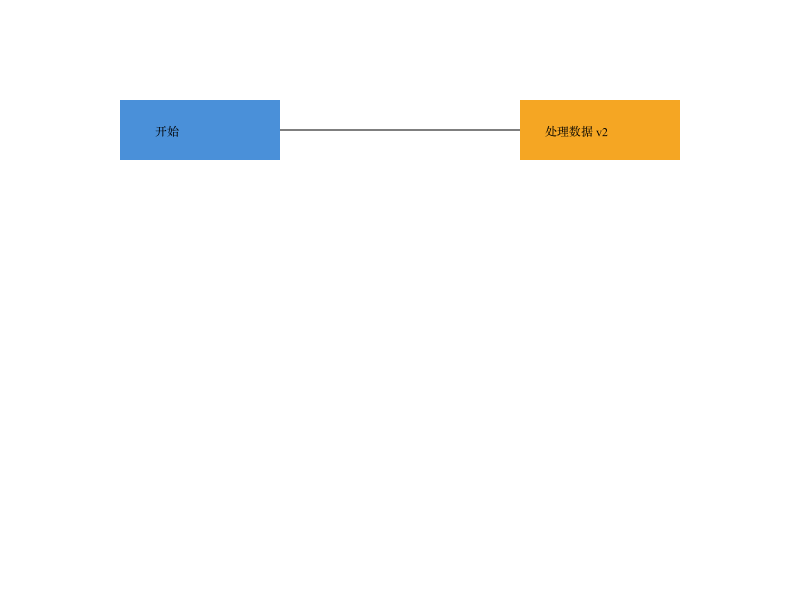
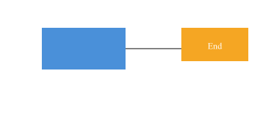

# SVG 编辑器 · Lab1 Phase 1

使用 TypeScript 面向对象实现的 SVG 命令行编辑器，采用 **Command + Composite + Memento**。提供六种图形、分组、绘制顺序、撤销重做和 SVG 文件读写；另含背景示例 transform 导入增强。

正式提交报告：**[doc/README.md](doc/README.md)** · [原始任务书](doc/phase_cli_1.md) · [架构图](doc/architecture.svg)

**详细使用手册：[doc/USER_GUIDE.md](doc/USER_GUIDE.md)**，在一个文件中集中说明环境准备、全部命令、参数、操作回显、图形效果、脚本及常见问题。

## 安装与运行

运行兼容范围为 Node.js 22 或以上；开发环境通过根目录的 `.nvmrc` 固定为 **Node.js v24.22.1**。依赖版本由 `package-lock.json` 锁定。

已安装 nvm 时，从项目根目录首次配置：

```sh
nvm install
nvm use
npm ci
npm run cli
```

`nvm install` 和 `nvm use` 不带版本号时会读取 `.nvmrc`，分别安装、选择指定版本。该文件是版本声明，不包含运行时；进入目录不会自动切换版本。

以后在新终端进入项目后执行：

```sh
nvm use
npm run cli
```

依赖没有变化且 `node_modules` 完整时，无需重复执行 `npm ci`。尚未安装 nvm 的用户可参考 [nvm 官方安装说明](https://github.com/nvm-sh/nvm#installing-and-updating)。

交互提示符为 `svg>`。使用 Ctrl+D 结束；整行 `#` 注释可以放入脚本。无需浏览器或图形界面即可编辑。

```text
init 800 600
create g scene
create rect r1 10 20 100 50 #4a90d9 in scene
create text title 20 50 "Hello SVG" in scene
move scene 30 10
undo
redo
tree
save demo.svg
```

`demo.svg` 可以直接拖入浏览器查看。相对文件路径以启动命令时的工作目录为基准。

## 脚本与生产构建

从项目根目录执行：

```sh
npm run cli < examples/flowchart.cli
npm run build
npm start < examples/flowchart.cli
```

脚本模式按顺序执行，在 EOF 退出，不输出提示符。单条命令失败输出一行 `error:`，随后继续下一条命令。

示例产物：[flowchart.svg](examples/flowchart.svg)



## 命令

| 类别 | 命令 |
|---|---|
| 文档 | `init [w] [h]`、`read <file.svg>`、`save [file.svg]`、`canvas [w] [h]` |
| 编辑 | `create`、`delete`、`move`、`scale`、`set` |
| 树结构 | `group`、`ungroup`、`addto`、`front`、`back` |
| 显示 | `tree [id]`、`show <id>`、`help` |
| 历史 | `undo`、`redo` |

图形创建语法：

```text
create rect <id> <x> <y> <w> <h> [fill] [in <gid>]
create circle <id> <cx> <cy> <r> [fill] [in <gid>]
create ellipse <id> <cx> <cy> <rx> <ry> [fill] [in <gid>]
create line <id> <x1> <y1> <x2> <y2> [stroke] [in <gid>]
create text <id> <x> <y> "content" [in <gid>]
create g <id> [in <gid>]
```

执行 `help` 查看全部命令参数。id 大小写敏感、全文档唯一。带空格参数使用双引号，文字内的双引号和反斜杠分别写为 `\"` 和 `\\`。

`set` 仅允许公共 `fill` / `stroke` / `stroke-width`、当前图形自身的几何属性以及文字的 `text`；不能用 `set` 修改 id。

编辑按一条命令撤销；成功执行 init/read/save 或修改画布尺寸后清空并禁用历史，直到下一次成功编辑。只读 canvas 不影响历史。根级 g 按任务书规定不能 ungroup。

## 验证

```sh
npm run check
npm run test:coverage
```

`check` 包含严格类型检查、自动化测试和生产构建，测试同时约束模块依赖方向、一类一文件与无循环依赖。GitHub Actions 会在 push 和 pull request 时执行相同检查。

支持范围、设计取舍、真实迭代过程和验收结果均记录在 [正式报告](doc/README.md) 中。


## transform 优化

```sh
npm run cli < examples/transform.cli
```

支持 translate、正等比 scale 和嵌套组合。导入时将变换归一化为几何坐标，同时处理字号和线宽，保存后的 SVG 保留显示效果与分组，省去原始 transform 属性。



不支持 rotate / skew / 非等比 scale / 任意 matrix。遇到超出范围的结构会报错，保持当前文档不变。完整范围和验证数据见正式报告。

最终验收：76 项自动化测试、严格类型检查、生产构建及两个示例的源码/构建版回放通过。`final` 标签保留在 2026-10-20 的原交付版本；后续 Node.js 环境配置以独立提交加入 `main`，不移动该标签。过程与限制详见正式报告。
