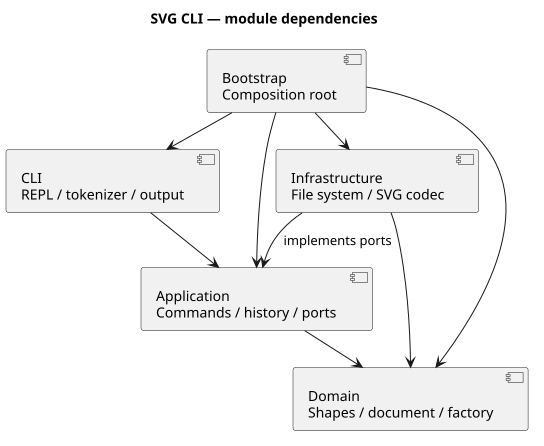

# Lab1 Phase 1：SVG 编辑器架构与开发报告

任务书：[phase_cli_1.md](phase_cli_1.md)；运行入口：[工程 README](../README.md)。本项目使用 TypeScript 面向对象实现，源代码一类一文件、字段封装、行为通过多态执行。

## 本阶段交付结论

2026-10-24 重新对照任务书后，Phase 1 的必做功能、实现范式及文档要求均已完成，当前复核未发现阻塞交付的实现缺口，具备作为本阶段课程作业提交的条件。依据包括 19 条命令的实际回放、六类图形的属性与历史验证、Command 等模式的落地、架构依赖检查，以及可追溯的分步 Git 历史；不以测试数量代替逐项需求核对。

**范围必须区分**：任务书第 3 节限定本阶段内置 rect/circle/ellipse/line/text/g；第 4.4 节和第 6.1 节版本 B 明确将 box 放在后续插件化阶段。因此未实现 box、ShapeProvider 动态插件或完整 SVG/CSS 引擎不是本阶段缺项。当前 create box 返回未知类型，符合阶段约定。translate / 正等比 scale 导入和可选基础样式保留属于额外成果。

课程最终交付由 **final** 标记，指向包含本说明的最终收束提交，与远端 main 一致，包含完整业务代码、环境配置、使用手册、逐项复核、后续设计预案，以及可重复验收脚本、用例和实际证据。用户已在 2026-10-26 明确确认尚未超过提交截止时间，并批准完成文档收束、独立提交及 final 更新。时间判断依据用户确认，标签使用真实操作时间。后续设计均为预案，未创建插件分支、插件接口或 box 实现。

2026-10-26 的历史验收材料在 `0b62616` 独立提交，被测基线为 `2f5ef47`，最终由 `c9425dc` 收束。2026-10-27 启动入口修复后，该旧基线不能代表新代码；本次按两个提交推进：先提交经测试的功能修复，再针对该真实 SHA 重新采集原有 40 个主用例的证据。当前基线、源码树、测试树、实际测试数量和结果见 [可重复功能验收材料](acceptance/功能测试与结果记录.md)。用户已明确授权全部验证通过后推送并更新 final。

## 架构方案

### 模块划分

| 目录 | 职责与代表类 |
|---|---|
| `src/cli` | CliController 协调输入与应用服务；Repl 管理提示符、逐行执行和 EOF |
| `src/cli/parsing` | Tokenizer 识别引号、转义、整行注释，不截断颜色中的 # |
| `src/cli/formatting` | OutputFormatter 统一单行 error 前缀 |
| `src/application` | EditorSession 管理当前文档、路径和用例；Argument / TreeNode 定义输入展示边界 |
| `src/application/commands` | Command 及每条命令的具体类，封装参数和行为 |
| `src/application/history` | HistoryManager 管理历史，DocumentMemento 封装文档快照 |
| `src/application/ports` | CommandContext / ReversibleEdit 解耦接收者与历史；TextStorage / DocumentCodec 隔离 IO |
| `src/domain` | SvgDocument 维护树、根节点 id 和约束；Numeric / SvgValue / SvgId 校验值；UniformTransform 封装变换组合 |
| `src/domain/shapes` | Shape / GeometryShape 和 Rect、Circle、Ellipse、Line、Text、Group |
| `src/domain/styles` | 结构操作样式策略、继承值解析及受限的基础颜色校验 |
| `src/domain/factories` | ShapeFactory 集中创建图形，CLI 和 SVG 导入复用 |
| `src/domain/errors` | EditorError 表达领域及用例错误 |
| `src/infrastructure/filesystem` | LocalTextStorage 读写文件，临时文件加替换保证保存完整性 |
| `src/infrastructure/svg` | SvgCodec 进行 XML 转换；TransformParser 和多态语法对象解析变换 |
| `src/bootstrap` | StartupOptions 集中校验启动配置；Main 在校验通过后装配实例和依赖，不包含图形业务 |



可编辑的 PlantUML 源文件：[architecture.puml](architecture.puml)。

### 设计模式的选择及落地

**Command（任务书强制）**：每条命令有独立类。EditingCommand 定义 execute / apply / undo / redo，MoveCommand、GroupCommand 等实现具体用例。EditorSession 调用命令，HistoryManager 通过 ReversibleEdit 接口维护历史。CLI 不直接修改图形字段。

**Composite**：Shape 为统一抽象，Group 持有 Shape 子节点。move / scale 经由多态在叶子修改几何数据，在容器递归操作孩子。set 使用统一接口，g 允许公共样式，具体图形允许自身几何属性，Text 额外允许 text。删除容器删除整棵子树。

**Memento**：每次编辑在文档工作副本中执行；校验和修改全部成功才提交。命令保存前后快照，撤销、重做恢复完整状态。因此分组、跨父节点移动、删除子树和绘制顺序都可以一次准确恢复，也避免以浮点逆运算实现撤销的误差。快照不包含历史管理器自身。

代价是历史占用 O(文档大小 × 历史条数) 内存。对本 Lab 优先保证正确性，当前不设置历史上限；大文档场景再换差量记录。

**Factory**：ShapeFactory 是唯一的图形类型名分发点。几何与样式行为由图形对象实现，导入和命令代码不各写一套类型判断。

**Strategy（可选增强）**：ReparentingStylePolicy 抽象结构操作的样式处理。FollowParentStyles 保留普通启动行为，PreserveBasicStyles 在开启 --preserve-style 时准备最小必要补写；由 Bootstrap 选择并经 CommandFactory 注入三条命令。StyleResolver 解析受支持的继承值，BasicPaint 校验可保留的直接颜色。全部补写计划校验成功后才应用，结构与样式由原有 Command/Memento 统一提交或恢复。

按名称分发只保留两处：`CommandFactory` 的命令注册表与 `ShapeFactory` 的图形定义表。**两处均标注为后续插件化阶段的待重构项**。其他代码不使用 switch 分派图形，transform 解析使用多态语法对象匹配，没有增加第三张名称到实现的分发表。

本阶段不实现 ShapeProvider 动态插件，也不实现 box。`create box` 必须报未知类型。带 `data-kind="box"` 的外部 g 作为普通容器读入并保留标记，符合未安装插件时的降级语义；因此本阶段不存在需要触发“不能解组插件复合图形”错误的对象。

### 依赖方向规则

1. Domain 只能依赖 Domain，不依赖应用层、CLI、Node IO 或第三方 XML 库。
2. Application 可以依赖 Application / Domain，持久化通过自身接口表达。
3. CLI 可以依赖 CLI / Application，不直接访问领域内部状态；终端 IO 只在 REPL 边界发生。
4. Infrastructure 可以依赖 Infrastructure / Application / Domain，用于实现端口和数据转换，不能依赖 CLI。
5. Bootstrap 可以依赖所有层；其他层不得依赖 Bootstrap。
6. 包含 type import 在内禁止循环依赖。一类一文件，导出类名与文件名一致。

这些规则使编辑用例能够复用于 GUI / agent 输入，XML 库和存储方式能够独立替换。接口与领域对象之间仅在边界使用只读展示数据，不以公共数据袋代替领域行为。

### 变化点假设

| 可能变化 | 留下的结构 / 当前取舍 |
|---|---|
| 新增命令 | 命令对象和集中注册，后续引入注册接口 |
| 新增图形及 box | 统一图形抽象与工厂；后续建立 ShapeProvider，不提前实现插件加载器 |
| GUI / agent 输入 | 复用 CommandContext 和应用层，不绑定终端 |
| 更换存储或 XML 库 | 通过 TextStorage / DocumentCodec 隔离 |
| 大文档 | 当前封装树遍历查找，避免维护第二份可变 id 索引；需要时再增加索引和差量历史 |
| 更广泛 SVG | 独立转换层；当前不建设完整 SVG/CSS 渲染引擎 |

### 后续阶段开发设计（预案，未实施）

#### 范围、启动条件与版本隔离

本节是面向变化点的设计储备，不是 Phase 1 的待修复清单，也不构成开始下一阶段开发的授权。收到正式后续任务书和用户实施确认后，再核对并修订本预案；如与新任务书冲突，以新任务书为准。

建议从 final 建立独立工作目录及分支（候选名称 phase2-plugins），后续各批只推送该分支，不自动合并 main、不移动 Phase 1 的 final。阶段功能范围为 Provider 插槽、box 插件、标准 SVG 往返和显式本地插件加载；首轮不建设完整 SVG/CSS 引擎、GUI、远程插件市场或运行时热卸载。

#### 架构与 Provider 合约

先进行一次有回归保护的核心扩展接口改造，再接入 box；目标是插槽建立后，新增图形插件只增加插件和注册配置，不再改动核心业务。不能把第一次建立插槽所需的核心改动也描述为“零改动”。

| 设计位置 | 后续职责与约束 |
|---|---|
| 稳定的插件 API 边界 | 提供版本号、Provider 合约、必要的图形/容器基类和只读视图；不暴露 EditorSession 内部文档或历史数组 |
| ShapeFactory | 保留唯一的类型名注册与查找点；内置六类也迁移为 Provider；统一检查重复类型、创建 schema、SVG 类型/标记恢复规则 |
| CommandFactory | 仍是唯一的命令名分发点；create/help 从注册信息生成语法，其他命令操作 Shape 能力，不写 box 名称判断 |
| 图形对象 | 通过多态提供移动、缩放、属性语义、clone、显示摘要、容器权限和序列化视图；不能用公共字段袋代替行为 |
| SVG 基础设施 | 负责 XML、转义、根 id、自动 id 和变换归一化；消费通用序列化/恢复合约，不按 box 名称再写一套分派 |
| 插件加载基础设施 | 读取显式本地模块路径、校验 API 版本并暂存注册结果；文件系统与动态导入不进入 Domain |
| Bootstrap | 选择启动参数、加载插件、注册内置 Provider 并装配 CLI；不包含 box 排版或属性传播规则 |

Provider 合约至少描述：类型名与版本、创建参数 schema、创建对象、可识别的 SVG 标记及其结构版本、恢复已有子树、help 信息。对象自身负责 set/clone/显示等多态行为；不在 Provider 和其他层各自维护重复的类型分发表。插件 id 的去重集合用于校验，不另建图形名到实现的路由。

依赖方向沿用现有规则：Domain 不访问 Node IO 或 XML 库；Application 消费 Domain 和端口；Infrastructure 实现 IO；插件只依赖公开 API，不能反向导入 CLI 或应用内部实现。新增 API 边界与插件目录后，必须同时修订架构图、允许依赖矩阵及架构测试，未记录的依赖违规作为待处理项。

#### box 的领域行为与内部结构

按任务书 4.4 的目标语法设计 `create box <id> <x> <y> <w> <h> "<标题>" [in <containerId>]`。初版模板参照该节及 6.1 版本 B 的可复现坐标：矩形默认填充 #4a90d9，标题默认 x+20、y+h/2+5。排版常量在插件中封装；正式后续任务书若另定居中/自动测量规则，再调整布局策略，不将当前示意坐标和未来排版能力混写为已实现功能。

| 行为 | 计划语义与验收依据 |
|---|---|
| 创建与 id | 组合根使用用户 id，必需部件为 `<id>-rect` 与 `<id>-label`；创建前一次校验根 id、派生 id 与文档根及所有图形是否冲突，失败不留下半棵树 |
| move / scale | 整棵子树统一操作，包含额外嵌套对象；沿用 CLI scale 乘位置和几何尺寸的规则，不顺带改变字号、线宽 |
| set fill / label | fill 转发给内部矩形；label 改内部文本。其他公共属性的传播和允许值在插件 schema 中明确，未声明属性统一报 unknown attribute |
| group / addto / in | box 既是图形也是容器，可被收编、重新归属、嵌套普通图形或其他 box；继续禁止循环和祖先/后代同时分组 |
| delete / undo / redo | 删除整个组合及子孙；一次命令是一个撤销单元；快照恢复后保留具体类型与插件行为，不退化为普通 Group |
| ungroup | 通过多态的解组权限返回 cannot ungroup composite shape；在根级 box 上也应优先返回该错误，普通根级 g 仍返回原任务书规定错误 |
| 必需部件保护 | 插件校验必需部件的角色、类型和 id；会破坏必需结构的删除或移出操作明确拒绝，额外用户子节点仍按普通容器规则处理。此细则在后续实现前结合正式任务书复核 |
| tree / show | 保留容器树和关键几何信息，标注组合语义；展示派生信息与实际 SVG 属性分开，不能把 box 类型直接写成非标准 <box> 标签 |

样式保留需要专门的集成设计：用户 `set box fill` 的语义传播，与结构操作内部的容器样式补写不是同一动作。不能直接沿用内部补写调用用户 set 的方式，否则可能误改已有显式矩形颜色。应通过独立的多态呈现属性补写能力适配，并测试 box + --preserve-style 的组合；尚不能可靠处理的情况继续原子拒绝，不宣称完整外观保真。

#### SVG 往返与无插件降级

保存使用普通 `<g id="..." data-kind="box">`，内部仍是标准 rect/text/g。图形数按实际元素计算，元数据不影响浏览器显示；插件可以增加明确的结构版本标记，但不能靠运行时内存字段才能重新读取。

建议先按普通 SVG 树解码、保留全部显式 id 并完成变换归一化，再由 ShapeFactory 内的恢复入口自底向上让对应 Provider 校验并恢复语义对象。恢复过程采用已有子节点与真实坐标，不调用创建模板再生成一套部件，避免派生 id 冲突、重复缩放或重排标题位置。

| 读取条件 | 预期行为 |
|---|---|
| 对应 Provider 已注册且结构版本、必需部件合法 | 恢复为 box，后续 set label、clone、撤销等语义继续有效 |
| 对应 Provider 未注册 | 降级为普通 g，保留子树、样式、坐标及 data-*，可继续编辑和保存 |
| 已注册但标记结构损坏或结构版本不支持 | 明确拒绝整次读取，不改当前文档、默认保存路径和历史 |
| 任意节点出现重复 id、非法 XML 或超出 SVG 支持范围 | 沿用原有统一错误及读取原子性规则 |

降级只承诺普通图形内容可用；若用户在无插件状态下破坏了必需部件，再安装插件不保证能自动恢复语义。需要把此边界写入手册并以损坏输入测试验证。

#### 本地动态加载与生命周期

以下是候选启动约定，**当前程序尚未实现 --plugin**：启动时显式指定本地 ESM 模块路径，允许多个 --plugin，并可与 --preserve-style 组合。启动后不再热卸载插件；本轮不从网络搜索、安装或自动运行插件。

加载顺序计划为：解析参数 → 注册内置 Provider → 依次导入显式模块 → 校验插件清单/API 版本 → 在临时注册集合检查全部声明 → 成功后一次提交注册结果 → 启动 REPL。清单至少包含插件 id、插件版本、API 版本和注册入口。

文件不存在、模块执行失败、清单错误、API 版本不兼容、插件 id 重复或类型名冲突时，输出可定位的启动错误并以失败状态退出，不进入半注册的会话，不允许静默覆盖内置类型。注册事务只覆盖宿主的注册表，不将本地任意模块描述为已经沙箱隔离。

源码入口与构建入口分别加载对应输出的插件，公开 SDK 必须解析到同一份核心类，避免 src 与 dist 两套类导致容器识别或 clone 失效。实施时用两个实际启动入口分别验证，不仅测试导出的注册函数。

#### 分批实施与完成门槛

| 批次 | 交付内容 | 进入下一批的条件 |
|---|---|---|
| A：扩展合约 | API 边界、Provider 注册与内置六类型迁移，更新架构方案 | 不加载插件时届时全部既有测试（含启动参数校验）及任务书会话通过，既有输出保持兼容 |
| B：box 行为 | 插件模板、派生 id、属性传播、容器规则及 clone | 4.4 的操作矩阵逐项通过；循环、重名、损坏必需部件和失败历史均有测试 |
| C：持久化 | 标准 SVG 序列化、语义恢复、无插件降级及结构版本 | 有/无插件读写往返、变换、根 id、嵌套 box、重读后编辑和历史恢复通过 |
| D：动态加载 | 显式模块路径、版本/冲突校验及原子注册 | 源码与构建入口、多个插件、带空格路径和加载失败均验证；另用测试插件证明新增类型不改核心业务 |
| E：整体验收 | 回放 6.1 版本 B、双模式及样式策略组合，更新手册和过程记录 | 全部回归、类型检查、构建、实际 CLI、标准 SVG 预览和架构检查通过，已披露剩余边界 |

每批先复现/定义目标用例，再实现、运行完整检查，最后单独提交并推送后续分支。发生回归时停留在该批处理，不通过时不推送为完成结果；不以旧的覆盖率、测试数量或截图片段冒充新阶段验收结果。阶段结束后再由用户确认是否合并或发布，不重用/移动 Phase 1 的 final。

#### 更远期的可选主题

更广 SVG/CSS、复杂透明度保真、相对长度、更多变换、历史容量与大文档性能，均应在出现明确需求后独立立项：先定义支持矩阵和反例，再确定数据模型、实现与验收方式。引入样式表时必须处理层叠、选择器及有效值，不能用简单复制属性宣称完整 CSS 支持。这些主题不作为当前交付缺项，也不自动加入下一阶段承诺。

### 对任务书未明确处的补充决策

- 同父分组占据最早被选节点的位置；跨父分组放在根层最早受影响顶层分支的位置。孩子保持编辑前全树先序遍历顺序，不按命令参数顺序重排。
- `addto` 将节点作为目标容器最后一个孩子；禁止自包含和祖先移入后代。
- `front` 为同级最后绘制，`back` 为最先绘制。严格禁止解组根级 g。
- `set g fill` 等设置 g 自身属性，效果遵循 SVG 样式继承；不强行覆盖孩子已有的显式样式。
- CLI `scale` 只乘位置与尺寸，不改变线宽或字号；text 的几何属性仅 x/y。
- 数值必须有限；画布尺寸为正；图形尺寸、半径、线宽非负；缩放因子为正。
- init 的默认尺寸为 800×600；只给宽度时高度使用 600。
- 首次保存新建文档必须给路径，成功保存后记住该路径；init 清空原路径。
- 成功 init/read/save 或 canvas 修改尺寸后清空历史并设置禁用标记；下一条成功编辑解禁。失败命令不改变文档、路径、历史和禁用状态。只读 canvas 不影响历史。
- 缺 id 时先保留全部显式 id，再按标签序号补全；整次导入成功后才输出警告。显式重名导致整次读取失败。
- SVG 根节点 id 作为可选的文档信息保存，使用 SvgId 与图形共用原有校验规则；与全部图形共同检查唯一性。缺失时不为文档根自动补 id，根不计入图形数量、不作为普通图形编辑目标；init 清除旧根 id。

### SVG 支持范围与 transform 优化方案

支持六种图形及约定的几何与样式。纯文字 text，不支持 path、tspan、defs、CSS style、百分比或相对长度。几何长度可导入纯数字及 px。viewBox 仅接受与画布一致的 `0 0 width height`。对不支持的结构明确报错，避免静默丢图。

除任务书属性外，导入保留 font-size、text-anchor、font-family、font-weight、opacity、fill-opacity、stroke-opacity 和 data-*；CLI set 仍使用原任务书白名单。XML 由 `@xmldom/xmldom` 解析和转义，使用严格错误回调，拒绝 DOCTYPE。[官方 API 依据](https://github.com/xmldom/xmldom)。

transform 在基础功能验收后独立增强，支持：

- `translate(tx[,ty])`；`scale(s)` 和 `scale(s,s)`，比例必须为正且有限。
- 浮点、科学计数法、空格或逗号分隔、同节点组合、父子嵌套。
- 不支持 rotate、skew、非等比 scale 或任意 matrix。

选择**导入时归一化**：UniformTransform 以 `parent(local(p))` 合成变换，SvgCodec 从根向叶传递累计值，只对叶子应用一次。归一化同时处理继承线宽和文字字号，保存为普通 SVG 并保留分组。

这样现有 move / scale / group / addto 可以继续使用统一几何坐标，无需每条命令计算逆矩阵。代价是保存不能保留原始 transform 写法，可能增加显式线宽和字号。CLI scale 与导入变换的排版缩放使用独立方法，避免改变任务书命令语义。

## 过程记录

以下记录均来自本次真实讨论、实现和验证，没有虚构人工审查或测试结果。

| 阶段 / 提交 | 讨论、实现与证据 |
|---|---|
| 设计 `8a4f6e8` | 完整阅读任务书，用户确认技术路线。区分背景 transform 与明确必做命令；用户批准完成基础版本后再独立增强。建立工程、文档、锁文件并推送空仓库。 |
| 领域 `b66caf8` | 封装六种图形和文档树，验证嵌套移动、复制独立性、唯一 id、白名单及尺寸约束，8 项测试通过。 |
| 命令与历史 `4d40a03` | CLI 和事务历史一并接入，避免建立绕过事务的临时编辑路径。测试溢出失败、历史屏障及 redo 清空，累计 15 项。 |
| 树操作 `a136a93` | 接入分组、解组、重新归属和绘制顺序，验证父容器及节点顺序精确恢复，累计 21 项。 |
| 文件 `bc8db78` | 接入存储和编解码端口，验证读写往返、补 id、重复 id、坏 XML、失败 IO，累计 34 项。DOM localName 的可空类型问题由类型检查发现并修复。 |
| 基础验收 `1e72db5` | 任务书会话和流程图回放、架构检查、生产构建、报告和架构图完成，51 项测试通过。 |
| 优化 `6ea667a` | 先增加 transform 用例，基础版 9 项有效变换用例失败，确认限制；实现后全部通过，累计 71 项。该功能使用独立提交并推送。 |
| 最终修复 | 审查发现非法 XML 字符可使保存文件无法读回，新增测试复现，再通过 SvgValue 校验修复。补充合法中文及 supplementary Unicode 往返测试，累计 76 项通过。 |

关键修订依据：

1. **依赖循环修正**：架构测试发现 EditorSession 和命令之间存在 type import 循环。即使没有运行时循环，也违反设计规则，因此抽出 CommandContext / ReversibleEdit，重新检查通过。
2. **启动方式修正**：实际回放发现 tsx 启动器在受限环境建立 IPC 失败，改为 `node --import tsx`，保持 `npm run cli` 不变。随后脚本回放成功。
3. **交互 EOF 修正**：终端测试发现输入关闭后仍请求提示符会抛错，增加 close 状态检查，保留已读命令的串行执行。
4. **变换重复处理防护**：累计变换只作用于叶子，避免 Group.scale 递归与导入递归叠加造成重复缩放；专项测试覆盖抵消缩放和样式继承。
5. **预览方式修订**：浏览器工具禁止 file 协议，未绕过；使用本地 SVG 渲染器生成 PNG 并视觉检查，报告不声称已完成浏览器人工预览。

初次开发时本机默认无 Node.js，使用已有运行环境和标准 npm 完成验证。Git 作者使用已认证 GitHub 资料与 noreply 地址，仅设置在本仓库；代理也只设置在本仓库，未修改全局设置。

### 2026-10-24：固定开发环境版本

- 用户已通过 nvm 安装 Node.js 并完成一次基本 CLI 操作，随后确认补充精确版本声明并上传 GitHub。
- 核验 nvm 安装目录中的 Node.js 为 `v24.22.1`，新增根目录 `.nvmrc` 记录该版本，并更新工程 README 的首次配置和日常运行步骤。
- `.nvmrc` 是纯文本版本文件，不创建虚拟环境，也不自动切换终端版本。`nvm install` / `nvm use` 读取它选择运行时，项目依赖继续由 `package-lock.json` 管理。
- 本次仅修改 `.nvmrc`、工程 README 和本报告，不调整业务代码、依赖版本、运行兼容范围或 CI 配置；现有 CI 仍选择 Node.js 24 主版本。
- 配置完成后执行 `nvm use`，确认读取 `.nvmrc` 并选择 Node.js `v24.22.1`、npm `11.19.1`；`npm run check` 通过，包含严格类型检查、10 个测试文件共 76 项测试及生产构建。
- 本次作为独立环境配置提交推送至 `main`，保留原 `final` 标签指向 `ef90a19`。用户生成的 `demo.svg` 不纳入提交。

### 2026-10-24：补充详细使用手册

- 根据用户要求新增 [USER_GUIDE.md](USER_GUIDE.md)，将环境、功能、全部命令、参数、输入示例、终端回显和图形效果集中在一个 Markdown 文件中，并在工程 README 增加入口。
- 对照当前命令类核对语义，明确区分 Shell 和 svg> 输入位置、首次及日常 nvm 使用方式、历史屏障、根级解组限制、变换归一化和重新归属的样式边界。
- 通过当前 CliController 和隔离的内存文件存储回放 18 组会话、156 条输入，覆盖全部 19 个命令，核验预期成功与预期错误；使用实际回放结果生成手册中的完整会话，避免回显与实现不一致。
- 随后在临时目录中使用生产构建版再次回放全部 18 组会话，逐行比较输出均一致，并验证手册中的自定义脚本可写出真实 SVG。另检查 16 个目录锚点、17 段 Shell 命令语法及全部代码围栏。
- 本次仅新增手册及文档入口、过程记录，没有修改业务逻辑；保留原 final 标签及用户本地的 demo.svg。

### 2026-10-24：T01 创建参数校验

- 先新增回归用例，复现 create g in scene 被误认为成功及错误清空 redo 的问题。
- 在拆分尾部 in 子句后校验独立的类型与 id，缺少 id 时统一拒绝；保留六种图形使用 in 作为合法显式 id 的能力。
- 严格类型检查、85 项测试、生产构建全部通过；构建版回放任务书两段会话共 33 条命令以及 transform 示例，预期错误和保存结果正确。
- 此项独立提交推送，使用手册已同步；保留原 final 标签和用户 demo.svg。

### 2026-10-24：T02 show 属性布局

- 几何属性通过图元的多态只读视图集中显示在一行；样式随后逐行显示，文本内容置于最后，组不产生空白几何行。
- 新增 6 项输出格式与查询不影响历史的回归测试，重新生成手册中 17 组实际交互记录。
- 验证：类型检查、91 项测试、构建通过；构建产物完成任务书 33 条命令与 transform 文件往返检查。
- 本批独立提交；原 `final` 标签和用户的 `demo.svg` 保持原样。

### 2026-10-24：T03 无参数保存路径

- 区分成功读入路径与显式保存路径；读入文档另存副本后，无参数 save 仍保存到读入路径。init 清除关联，新建文档保留最近成功保存路径作为后备目标。
- 新增 3 项回归测试，先复现旧行为；覆盖副本内容不被后续默认保存覆盖、读取失败、保存失败、redo 保留和 init 清理。同步手册说明与交互回显。
- 验证：类型检查、94 项测试、构建，以及生产 CLI 的任务书会话和 transform 往返检查全部通过。
- 本批独立提交，保留原 `final` 标签和用户的 `demo.svg`。

### 2026-10-24：T04 group 成员下限

- 按任务书命令语法要求至少两个成员；领域层统一校验，CLI 对零成员和单成员返回明确错误。空容器仍通过 create g 创建。
- 新增 4 项 CLI / 领域回归，先复现单成员成功的问题，验证拒绝后图形、父级、redo 和新组 id 均保持可用；原有跨父分组、排序和撤销测试继续通过。
- 验证：类型检查、98 项测试、构建，以及生产 CLI 的任务书会话和 transform 往返检查全部通过。
- 本批独立提交，保留原 `final` 标签和用户的 `demo.svg`。

### 2026-10-24：T05 编辑与历史反馈

- 叶图元通过多态位置视图报告最终坐标；组报告增量，撤销报告恢复坐标或反向增量。set 撤销显示原值或省略状态，删除撤销显示原父容器。
- EditingCommand 保留快照恢复模板，各具体命令实现撤销摘要；redo 输出原成功摘要，不再统一添加 undone/redone 前缀。没有新增图形类型名称分派。
- 新增 9 项测试，先复现旧输出，逐字校验任务书反馈以及五种叶图元、嵌套组、浮点精度、文本转义、样式省略和拓扑恢复；同步手册全部实际交互记录。
- 验证：类型检查、107 项测试、构建通过；生产 CLI 通过任务书 33 条命令、transform 往返及手册 17 组会话 155 条输入的逐行输出比较。
- 本批独立提交，保留原 `final` 标签和用户的 `demo.svg`。

### 2026-10-24：T06 tree 列对齐与六批回归完成

- TreeNode 区分标签和属性摘要，TreeCommand 按包含层级前缀的最大显示宽度对齐属性列；保留树枝、绘制顺序、关键几何和样式，空组无尾部空格。
- 新增 5 项测试，先复现原布局差异；覆盖任务书树形输出逐字比较、跨层级长 id、带样式的子树根、空树、中文 / 组合字符 / emoji、查询不影响撤销和删除后重新计算列宽。
- 同步手册真实会话和根 README 的当前验收信息。类型检查、112 项测试、构建全部通过；生产 CLI 通过任务书 33 条命令、transform 往返及手册 17 组会话 155 条输入的逐行输出比较。
- T01～T06 分别验证、提交并推送；原 `final` 标签及用户 `demo.svg` 保持原样。

### 2026-10-24：根节点 id 兼容性修复

- 审核实际复现：有效的 svg 根节点带 id 时被当作样式并拒绝。先新增 22 项回归，其中 21 项在旧实现上失败，确认覆盖了缺口。
- SvgDocument 封装可选的只读根 id，克隆和快照携带该信息；SvgCodec 独立读写根 id，预留全部显式 id 时包含根，避免自动补 id 冲突。添加图形、整棵子树和分组时也检查根 id 重名。
- 将图形已有的 id 校验提取为同一领域模块中的 SvgId，供根与图形复用；六类图形、CLI 白名单、树标题、元素计数和按名称分派位置保持原有约定。同步手册的范围说明、补 id 示例和工程 README。
- 类型检查、134 项测试和构建通过；真实构建版 CLI 验证根 id 读写、冲突拒绝、失败原子性、undo/redo 和 init 清理，并重新回放任务书会话、手册 155 条输入、752 条补充审核输入及 transform 往返。
- 用户本次批准功能修复和独立提交推送，明确要求等待最终稿确认后再处理 final；因此本次不创建或移动任何标签，也不纳入用户 demo.svg。

### 2026-10-24：可选基础样式保留——功能板块

- 实际复现了解组和重新归属后继承颜色改变的问题；按用户确认的方案保留普通启动行为，并提供 --preserve-style 启动选项。
- FollowParentStyles / PreserveBasicStyles 实现统一策略接口，由装配入口注入命令工厂和三条结构命令；StyleResolver 处理根与祖先继承。仅在基础属性有效值改变时补写，所有补写计划校验完毕后才修改文档。
- 首批覆盖 fill / stroke / stroke-width；直接颜色支持命名色、transparent、none 和 3/4/6/8 位十六进制。旧有效颜色无法解析、额外继承属性变化或组 opacity 上下文变化时明确拒绝，使用原有事务和快照保证失败原子性与一个撤销单元。
- 新增 31 项测试；完整类型检查、165 项测试、构建通过。默认模式通过任务书 33 条命令、手册 155 条输入、752 条补充审核、根 id 检查及 transform 往返；增强模式另通过 59 条生产 CLI 输入与真实 SVG 文件核验。
- 本功能板块独立提交推送；下一板块补充详细手册和后续插件路线。final 标签、用户 demo.svg 保持原样。

### 2026-10-24：基础样式保留——文档与后续路线板块

- 功能板块 70d4ba1 推送后，补充普通/增强模式的启动方式、18 条正向与 8 条拒绝场景的完整会话、属性固化代价、颜色子集、额外继承值及组透明度保护条件。
- 在正式方案中说明 Strategy 的落地，并记录后续 Provider、box、动态加载及 SVG/CSS 的扩展路线；明确这些是后续设计，当前六类型和未知类型错误约定不变。
- 再次运行完整类型检查、165 项测试与构建；生产 CLI 逐行比较普通模式 17 组 / 155 条输入及增强模式 2 组 / 26 条输入，另验证 help。任务书、752 条补充审核、根 id、transform 往返和增强模式 59 条生产输入再次通过。
- 本板块只修改现有文档，独立提交推送；final 标签与用户 demo.svg 保持原样。

### 2026-10-24：用户确认 Phase 1 最终稿并更新 final

- 用户确认当前阶段基本完成，明确要求先更新 final，再提交 box 与动态插件阶段的方案；下一阶段实施仍等待用户批准。
- 对 59d0d7a 的业务代码再次运行完整类型检查、165 项测试、构建及实际 CLI 回放，验收通过；本次仅同步最终交付说明，不修改业务逻辑或用户 demo.svg。
- 在包含本发布记录的提交上更新附注标签 final 并推送 GitHub；原 final 曾指向 ef90a19，本次使用真实更新时刻，不改写历史提交时间。后续阶段使用独立分支，Phase 1 标签保持固定。

### 2026-10-24：收束 Phase 1 并补充后续设计

- 用户重新确认 box 等不是本阶段要求，要求先核查本阶段是否具备高质量作业交付条件，再只将完整后续路线写入文档。
- 重读第 1～6 节，逐项核查必做命令、范式、文档和 Git 历史；本阶段未发现新的阻塞性实现缺口，截止时间条件因未提供课程日期仍不能核验。
- 本轮类型检查、165 项测试、构建和覆盖率检查通过；覆盖率为行 99.68%、分支 91.56%、函数 100%、语句 97.45%。生产 CLI 回放任务书、手册、752 条审核输入、根 id 与可选增强均通过。
- 该轮只扩充报告的交付结论、需求核查矩阵和后续设计，并补充文档入口；没有实现 Provider、box 或动态加载，也未创建后续分支。业务代码与当时 final 所指的 41f00cc 保持一致；该次文档补充推送 main，当时未移动标签。

### 2026-10-24：文档收束后的最终交付确认

- 用户明确要求将补齐需求复核和后续设计的最终稿上传并标记 final。本次同步当前标签说明，保留前述各阶段的真实过程记录，不修改业务代码、依赖或用户 demo.svg。
- 再次运行完整类型检查、165 项测试、构建及实际 CLI 回放，通过后提交本次文档同步，将 final 更新到该最后提交并与 main 一并推送、核验远程位置。
- 最终标签现包含完整代码与文档；box、Provider 和动态加载仍只是后续设计，未实施。未来开发需另行确认，不自动改变本阶段最终标签。

### 2026-10-26：补充可重复的功能验收材料

- 用户要求仅补充验收与证据；以 `2f5ef47` 的提交快照隔离安装、构建和实际运行，保留个人 demo.svg，不修改业务源码、原有测试、依赖版本或 CI，不移动 final。
- 新增 40 个主用例、55 个子场景，预先确定 650 条输入及预期；源码/构建、普通/增强模式共执行 128 个主场景会话、48 个独立状态重放及 4 个真实 PTY 会话。1,674 条功能断言及 40 条终端断言全部通过，SVG 来自实际 save，8 张 PNG 来自真实浏览器渲染。
- 编写过程中发现并修正验收预期中的流程图列宽计算，以及 TypeScript 7 单文件检查所需的 --ignoreConfig / --types node 参数；没有为通过验收修改业务行为。收束后完整重跑通过，原有 165 项测试、类型检查、构建及覆盖率均通过。
- 从不含 demo.svg、node_modules、dist、coverage 的干净临时副本重新安装并执行默认验收，通过；前后证据哈希一致，原目录源码、测试、示例、配置、个人文件与运行产物保持原样。结果与限制集中在 [功能测试与结果记录](acceptance/功能测试与结果记录.md)，仅提交本轮允许的验收材料和入口。

### 2026-10-26：验收后最终交付收束

- 用户确认尚未超过提交截止时间，并批准统一交付说明、完成最终验证、独立提交及更新 final；原 final 指向 `2f5ef47`，main 已包含 `0b62616` 的验收材料。
- 仅调整工程 README、本报告和验收报告的当前标签说明，将旧标签位置明确为采集时的历史状态；原始验收基线 `2f5ef47`、用例、结果 JSON、SVG/PNG、日志和复跑证明均保留。
- 在文档收束后的工作区运行默认 `npm run test:acceptance`；以已提交的 `0b62616` 快照在临时目录重新安装、检查、构建并实际验收，业务代码与原基线一致。165 项自动化测试、类型检查、构建、1,674 条功能断言、40 条终端断言和覆盖率检查全部通过；默认模式未覆盖仓库内原始证据。
- 核查文档链接及文件差异后，以独立文档提交收束；在该提交上更新附注 final，将 main 与标签一并推送并核验远端位置。标签使用真实时间，不改写历史提交。后续阶段仍须另行确认。

### 2026-10-27：集中校验启动参数

- 实际复现旧入口用 includes 判断模式而忽略其他参数：拼错、未知或混合参数均以 0 启动，还执行了 stdin 的保存命令，可能使用户误判所选模式。
- 新增 Bootstrap 层 StartupOptions，只接受精确的 --preserve-style，重复合法参数幂等；拒绝位置参数、赋值写法及所有其他参数。解析类不访问 IO、不创建编辑器、不加载插件。
- Main 先解析全部启动参数，再创建工厂、会话和样式策略；仅在解析边界捕获错误，复用 OutputFormatter 写单行 stderr 并设置退出码 2。装配和 REPL 异常不被误报为参数错误；编辑器内部错误恢复行为保持原样。
- 新增 tests/startup-options.test.ts 的 37 项测试：13 项解析配置、24 项源码/新构建入口的正常启动与拒绝。错误进程精确比较退出码、stderr、空 stdout，并确认输入保存命令没有执行；正常进程验证实际样式保留及命令错误后的继续执行。
- 临时副本依次执行 typecheck、全部 202 项测试、build，结果通过。功能修复以独立提交记录；完整功能验收随后针对该提交采集，不把旧材料包装成新代码的验证。
- 验收生成器从实际 check 输出获取测试文件数和测试数，写入 summary.json 与报告，移除写死的 165。保留原 40 个主用例；本次不新增 SVG 功能、插件选项、依赖或 CI 修改。用户授权完整检查后推送并更新 final，Git 时间保持真实。

## 一致性自查

**模块划分是否一致？** 一致。Argument、TreeNode、命令接收者接口和 transform 语法对象是原模块内部细化；领域层增加 UniformTransform / SvgValue / SvgId，styles 子目录封装样式策略与解析。对应根 id 和样式增强均已记入模块表及过程记录。没有新增未说明的业务层或将 IO 放进领域模型。命令与历史合并为一个开发阶段的理由已记入过程记录。

**依赖规则是否违反？** 最终检查未发现违反。`tests/architecture.test.ts` 遍历全部源文件的本地导入，包括类型导入，验证允许的模块方向、外部依赖隔离、一类一文件、无循环依赖和无 switch 分派。

抽样关系：

- MoveCommand → SvgDocument / EditingCommand / CommandContext。
- HistoryManager → ReversibleEdit → DocumentMemento → SvgDocument。
- SvgCodec → DocumentCodec / ShapeFactory / UniformTransform。
- LocalTextStorage → TextStorage，文件系统只在其实现中访问。
- CliController → EditorSession / CommandFactory，无 Domain 导入。
- Main 装配各层，没有被其他模块引用。

代码内按名称分发仍只有命令工厂和图形工厂两处。没有公共几何数据袋，没有散落的图形类型 switch。当前没有待处理的依赖违规。

## 质量保证手段

可重复的完整功能验收入口：`npm run test:acceptance`；更新证据：`npm run test:acceptance -- --record`。使用提交快照在隔离临时目录安装依赖、检查、构建、运行真实 CLI 与 PTY，并生成覆盖率。完整步骤、逐步预期、实际结果、SVG/PNG、模式矩阵和限制见 [功能测试与结果记录](acceptance/功能测试与结果记录.md)，不以此替代原有自动化测试。

### 需求与验证对应

| 要求 | 验证位置 |
|---|---|
| 六种图形、多态几何行为、封装 | `tests/domain.test.ts` |
| 引号、颜色、注释、显示、无文档错误 | `tests/cli.test.ts` |
| 撤销重做、屏障、失败原子性 | `tests/history.test.ts` |
| 分组、解组、顺序、循环防护、子树删除 | `tests/topology.test.ts` |
| SVG 往返、补 id、重名、失败 IO、真实文件替换 | `tests/persistence.test.ts` |
| 根 id 往返、全局唯一性、自动避让、快照、初始化与失败读取 | `tests/root-id.test.ts` |
| 双启动模式、结构样式保留、原子拒绝、透明度边界、真实 CLI | `tests/preserve-style.test.ts` |
| 任务书完整会话、两节点流程图、指定错误、真实 CLI | `tests/acceptance.test.ts` |
| 交互提示符、EOF、串行输入、转义 | `tests/repl.test.ts` |
| 启动参数、错误退出、无副作用、两个入口及重复合法参数 | `tests/startup-options.test.ts` |
| 模块边界、类文件名、循环依赖 | `tests/architecture.test.ts` |
| 背景变换、顺序、排版、编辑、往返、非法变换 | `tests/transform.test.ts` |
| 非法 XML 字符拒绝、合法 Unicode 往返 | `tests/xml-values.test.ts` |
| show 几何与样式分行、组与文本布局 | `tests/show-format.test.ts` |
| 编辑结果、撤销恢复状态、重做成功摘要 | `tests/feedback.test.ts` |
| tree 对齐、层级、子树、Unicode 显示宽度 | `tests/tree-format.test.ts` |

### 2026-10-24：Phase 1 逐项复核结果

以下为 2026-10-24 对基线 41f00cc 的历史功能复核，覆盖当时的业务实现；其后的启动入口修复及当前代码验证以 2026-10-27 过程记录和最新验收基线为准。后续设计中的能力不计为已实现。

| 本阶段要求 | 实际核查与结论 |
|---|---|
| init | 默认 800×600、单宽参数补默认高、显式浮点尺寸、新文档替换及清空路径/历史均通过 |
| read | 六类型及嵌套、缺 id 补全并警告、先避让显式 id、重名拒绝、失败保留文档与历史、成功读取设置历史屏障均通过 |
| save | 标准 SVG 输出、文本转义、默认读入路径、另存副本、写入失败及历史屏障均通过；根 id 额外兼容已验证 |
| canvas | 查询不占历史；修改只改画布尺寸，不隐式缩放内容；非法尺寸不改状态，成功修改设置屏障 |
| create | rect/circle/ellipse/line/text/g 参数、必填独立 id、可选 paint、省略属性不强写默认、六类 in 子句和目标容器校验通过 |
| delete | 删除叶子或整棵容器子树，撤销恢复全部子孙及可寻址性 |
| move | 五类叶子的坐标与线两端更新，嵌套组递归平移；回显、浮点与溢出失败保护通过 |
| scale | 位置和几何尺寸同乘因子，容器递归；非正数拒绝；未额外改变 CLI 线宽或字号 |
| set | 全部公共属性、各类型几何白名单、text 内容及空文本/转义通过；未知属性明确拒绝 |
| group | 至少两个不同成员、保持原相对顺序、同父与跨父收编、祖先/后代冲突、一次撤销恢复均通过 |
| ungroup | 嵌套普通 g 的孩子提升并占据原位置，根级 g 拒绝，撤销准确恢复；复合图形错误分支属于未实现的后续 box，不列为本阶段缺项 |
| addto | 移入后为最后一个孩子；容器目标、循环防护、一次撤销恢复通过 |
| front | 调整到同级最后绘制，保留其他同级顺序及子树，撤销恢复 |
| back | 调整到同级最先绘制，保留其他同级顺序及子树，撤销恢复 |
| tree | 全文档/指定子树、关键几何内联、文本与样式、层级、列对齐及 Unicode 显示测试通过 |
| show | 类型/id/父级、几何合行、样式明细和文本内容符合展示约定，查询不改变历史 |
| help | 包含全部 19 条命令和六类创建语法；未 init/read 时也可查询 |
| undo | 每条成功编辑为一个单元；结构与样式快照恢复，文档类屏障、失败命令不消耗历史通过 |
| redo | 恢复已撤销的编辑；新成功编辑清空 redo，显示和失败操作不清空，屏障规则通过 |
| 通用交互 | svg>、逐行串行执行、空行/整行 # 注释、颜色 # 不截断、双引号/转义、大小写敏感 id 和单行 error 前缀通过 |
| OO 与模式 | 生产业务类一类一文件、图形字段封装、叶子/容器多态；Command 强制模式落地，Composite/Memento/Factory/Strategy 的职责与代码相符 |
| 依赖与变化点 | 架构图、模块职责、允许依赖、变化假设齐全；含 type import 的依赖/循环检查通过；两个名称分发点均标注待重构 |
| 必交文档与过程 | doc/README.md 为 Markdown，包含架构方案、真实讨论/修订记录、一致性自查、质量保证；另有完整使用手册 |
| Git 交付 | 历史体现设计、领域、命令、IO、验收及优化的分步推进；该次文档收束时 final 与 main 同指 2f5ef47。随后新增验收材料及最终标签收束见上方 2026-10-26 过程记录；当时尚未确认的截止时间条件，现已有用户明确确认 |

质量判断依据是上述需求与实际结果的一致性、合理的模式和边界、失败原子性、可复现环境及已披露限制，不能据此保证任意未知输入无缺陷或预判教师评分。普通模式的继承样式变化、SVG 子集和历史内存开销已披露；可选增强不改变本阶段默认命令约定。

本轮重新执行结果：15 个测试文件 / 165 项测试全部通过，严格类型检查、生产构建与覆盖率检查通过；行覆盖率 **99.68%**、分支 **91.56%**、函数 **100%**、语句 **97.45%**。仍排除纯装配入口 Main，子进程执行不计入父进程覆盖率，不把该数字当作功能完备性的唯一证明。

生产 CLI 另回放任务书两段会话 33 条命令、手册普通/增强模式共 181 条输入加 help、覆盖全部 19 条命令的 752 条补充审核输入、根 id 15 条输入和增强模式 59 条输入；保存结果及预期错误均通过。所有实际写出文件均位于隔离临时目录，用户 demo.svg 未被覆盖。任务书会话、关键展示与错误还由仓库中的回归测试持续保护。

### 历史交付验收（2026-10-20）

2026-10-20（Asia/Shanghai）完成：

- 从锁文件重新执行 `npm ci`，安装成功，依赖审计 0 漏洞。
- `npm run check` 通过：严格类型检查、**10 个测试文件 / 76 项测试**、生产构建。
- `npm run test:coverage` 通过：行 **99.43%**、分支 **88.20%**、函数 **100%**。覆盖率排除纯装配入口，子进程执行不计入父进程统计。
- `npm run cli` 与构建后的 `npm start` 均完成流程图和 transform 脚本回放。
- 任务书流程图保存为 8 个元素；背景变换图保存为 6 个元素，补 id 警告正确。
- Git diff 空白检查通过。GitHub Actions 已配置 push / pull_request 时运行同一套检查；本报告的通过结论依据本地实际运行，不冒充远程工作流结果。

### 图形检查

示例：[flowchart.svg](../examples/flowchart.svg)、[transform-original.svg](../examples/transform-original.svg)、[transform-normalized.svg](../examples/transform-normalized.svg)。


背景原图与归一化图使用同一本地渲染器比较：400×200 像素、320000 个 RGBA 通道值中，44 个不同，最大差 2/255，平均绝对差 0.000140625/255。存在微小光栅化差异，不宣称逐像素完全一致。[原始比较数据](transform-render-check.json)。

用户可将 SVG 直接拖入浏览器进一步检查，无需安装编辑器插件。

### GitHub 交付

2026-10-20，代码按上述阶段真实提交并推送至用户指定的私有仓库。transform 优化是基础验收后的独立变更。原交付代码和报告提交后，在 `ef90a19` 创建附注标签 **`final`**，随后推送并核验当时远程 main 与标签均指向该提交。

2026-10-24 的环境配置、详细手册及后续功能修复开发期间，经用户确认曾保持原 final 不变。全部修复和可选增强验收后，用户首次确认本阶段完成，将 final 更新到 **41f00cc**；随后 **ecb85a8** 补充逐项复核和完整后续设计。用户再次要求将补齐文档的最终稿一并标记 final，该次将附注标签更新到 **2f5ef47** 并与 main 一并推送、核验。

2026-10-26，**0b62616** 独立补充可重复验收材料，采集时按要求保持 final 在 2f5ef47。随后用户确认仍在截止时间之前，批准本次最终收束：同步三份 Markdown 的交付说明、重新运行默认验收，在包含完整材料和本说明的最后文档提交上更新附注 final，并与 main 一并推送、核验。原始验收证据仍引用真实被测基线 2f5ef47；最终业务代码与该基线一致。后续 box 与动态插件只保留设计预案，实施前另行确认，在独立分支推进。

最终提交与标签的真实时间可通过以下命令查验：

```sh
git log --oneline --decorate
git show --no-patch final
git ls-remote origin refs/heads/main refs/tags/final 'refs/tags/final^{}'
```

**用户已在 2026-10-26 明确确认本次最终收束尚未超过课程截止时间。** 本次按该确认执行；具体截止日期未写入原任务书，标签及提交均记录真实操作时间，不回填或修改时间。
